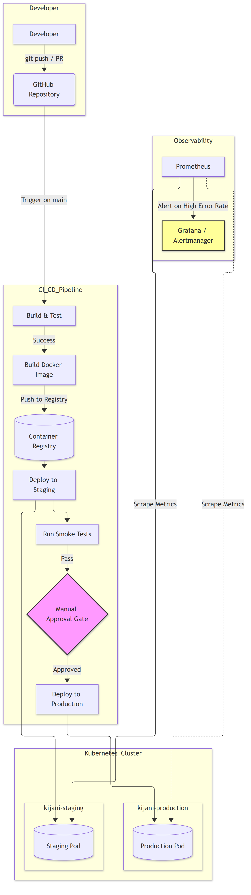
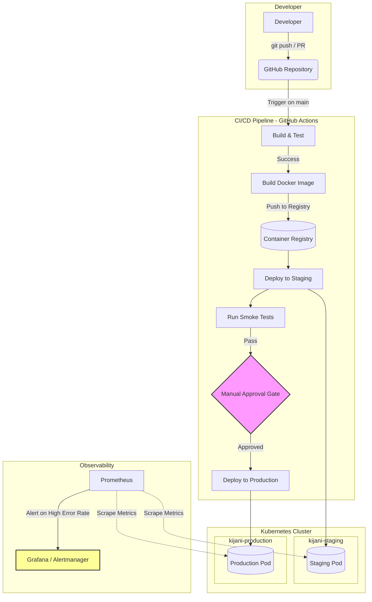

# KijaniKiosk Infrastructure Pipeline

[](https://github.com/ob002/kijani-kiosk-capstone/actions/workflows/deploy.yml)

Welcome to the KijaniKiosk Capstone Project. This repository contains the production-grade DevOps infrastructure, CI/CD pipelines, and observability configurations for the KijaniKiosk eco-friendly ticketing API.

> **Core Objective:** A new engineer should be able to clone this repository, understand the architecture, and deploy a meaningful change to the staging environment within their first day.

## Architecture



**High-Level Flow:**  
`GitHub Push` → `GitHub Actions (Build/Test)` → `Deploy to Staging` → `Smoke Test` → `Manual Approval Gate` → `Deploy to Production` → `Prometheus/Grafana Monitoring`

## Technology Stack
- **App:** Python 3.12 (Flask)
- **Container:** Docker
- **Orchestration:** Kubernetes (Namespace isolated: `kijani-staging` & `kijani-production`)
- **CI/CD:** GitHub Actions (with Environment Protection Rules)
- **Observability:** Prometheus + Grafana

## Getting Started (Local Development)

### Prerequisites
- Python 3.12+
- Docker
- `kubectl` and a local Kubernetes cluster (Minikube or Kind)

### 1. Run the App Locally
```bash
cd app
python3 -m venv venv
source venv/bin/activate  # On Windows: venv\Scripts\activate
pip install -r requirements.txt
python app.py
```
Visit `http://localhost:5000/health` to verify.

### 2. Build and Test the Docker Image
```bash
docker build -t kijani-kiosk:local ./app
docker run -p 5000:5000 -e ENVIRONMENT=local kijani-kiosk:local
```

### 3. Run Smoke Tests
```bash
chmod +x scripts/smoke-test.sh
./scripts/smoke-test.sh http://localhost:5000
```

## Deployment Pipeline
This project uses GitHub Actions (`pipeline/deploy.yml`).
1. Pushing to `main` triggers the `build-and-test` and `deploy-staging` jobs automatically.
2. The `deploy-production` job is protected by a **Manual Approval Gate** (configured in GitHub Settings → Environments → `production`).
3. Kubernetes manifests are separated by environment in `infra/k8s/`, with production enforcing stricter resource limits and higher replica counts.

## Repository Structure
```text
├── app/                  # Python Flask application & Dockerfile
├── docs/                 # Scope, Architecture, Peer Feedback, Reflection
├── infra/k8s/            # Kubernetes manifests (staging & production)
├── pipeline/             # GitHub Actions CI/CD workflow
├── scripts/              # Automation and smoke test scripts
└── README.md             # You are here!
```

## Peer Feedback & Governance
- See [docs/peer-feedback-log.md](docs/peer-feedback-log.md) for resolved improvements.
- See [docs/scope-document.md](docs/scope-document.md) for AI governance and integrity statements.

---
<details>
<summary><strong>📊 Architecture Diagram (Mermaid)</strong></summary>


</details>
