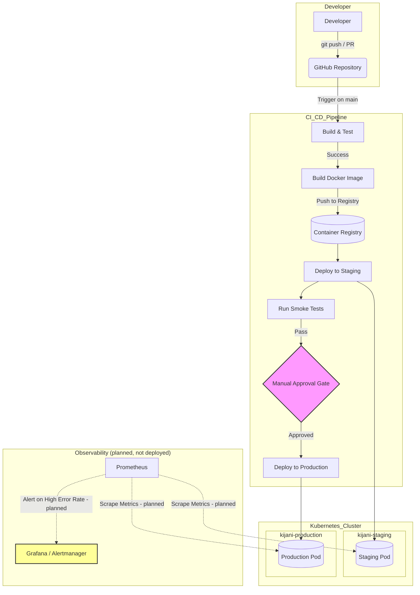

# 🌿 KijaniKiosk Infrastructure Pipeline

[](https://github.com/ob002/kijani-kiosk-capstone/blob/main/Jenkinsfile)

> **Core Objective:** A new engineer should be able to clone this repository, understand the architecture, and deploy a meaningful change to the staging environment within their first day.

---

## 1. 🗺️ Architecture


**Four-Layer Flow:**

| Layer | Component |
|-------|-----------|
| Infrastructure | Terraform provisions namespaces · Ansible configures staging |
| Delivery | GitHub Actions: build → test → staging deploy → smoke test → approval gate → prod deploy |
| Runtime | Kubernetes: `kijani-staging` (2 replicas) · `kijani-production` (3 replicas + resource limits) |
| Intelligence | Prometheus + Grafana (planned) — alert rules written in `infra/prometheus-alerts.yaml`, not yet deployed |

---

## 2. 🛠️ Technology Stack

- **App:** Python 3.12 (Flask)
- **Container:** Docker (with `.dockerignore`)
- **IaC:** Terraform + Ansible
- **Orchestration:** Kubernetes — namespace isolated (`kijani-staging` / `kijani-production`)
- **CI/CD:** Jenkins (Multibranch Pipeline — `Jenkinsfile` at repo root, manual approval gate with reason capture)
- **Observability:** Prometheus + Grafana (planned) — alert rules committed to `infra/prometheus-alerts.yaml`; deployment of `kube-prometheus-stack` and ServiceMonitor is a Production Gap

---

## 3. 🚀 Getting Started (Local Development)

### Prerequisites
- Python 3.12+
- Docker
- `kubectl` + Minikube or Kind

### Run the app locally
```bash
cd app
python3 -m venv venv
source venv/bin/activate
pip install -r requirements.txt
python app.py
```
Visit `http://localhost:5000/health` to verify.

### Build and run with Docker
```bash
docker build -t kijani-kiosk:local ./app
docker run -p 5000:5000 -e ENVIRONMENT=local kijani-kiosk:local
```

### Run smoke tests
```bash
chmod +x scripts/smoke-test.sh
./scripts/smoke-test.sh http://localhost:5000
```

---

## 4. 🏗️ Deployment Pipeline

The pipeline is defined in `Jenkinsfile` at the repo root. Jenkins picks it up automatically via a Multibranch Pipeline job.

1. Push to `main` → Jenkins triggers **Checkout → Build → Test → Deploy Staging → Smoke Test**
2. Smoke test must pass before the pipeline proceeds
3. **Approval Gate** pauses the pipeline and prompts for a reviewer name and a mandatory reason before production deploy
4. Kubernetes manifests in `infra/k8s/` are environment-specific — production enforces 3 replicas and resource limits via separate ConfigMaps

### Pipeline Stages
```
Checkout → Build Docker Image → Run Tests → Deploy to Staging → Smoke Test → Approval Gate → Deploy to Production
```

### Fault Scenario (Demo)
```bash
# Kill a staging pod — Kubernetes restarts it automatically via liveness probe
kubectl delete pod -l app=kijani-kiosk -n kijani-staging
# Watch recovery
kubectl get pods -n kijani-staging -w
```

---

## 5. 📂 Repository Structure

```text
├── app/                        # Flask app, Dockerfile, .dockerignore
├── docs/
│   ├── scope-document.md       # CAP-1: project scope, four layers, success criteria
│   ├── ai-governance-log.md    # CAP-3: every AI use, what it got wrong, human action
│   ├── test-plan.md            # CAP-6: written before peer review session
│   ├── peer-feedback-log.md    # CAP-6: 3 issues, severity, commit evidence
│   ├── reflection.md           # CAP-8: specific wrong decision, changed thinking
│   └── architecture.png        # Generated from Mermaid
├── infra/
│   ├── ansible/
│   │   └── configure-staging.yml   # Ansible: configure staging post-Terraform
│   ├── k8s/
│   │   ├── staging-configmap.yaml  # DB_HOST=kk-payments-staging-db
│   │   ├── staging-deployment.yaml
│   │   ├── prod-configmap.yaml     # DB_HOST=kk-payments-prod-db
│   │   └── prod-deployment.yaml    # 3 replicas + resource limits
│   └── prometheus-alerts.yaml      # Alert rules on kk-payments signals
├── pipeline/
│   └── deploy.yml              # GitHub Actions workflow (copy — canonical: .github/workflows/)
└── scripts/
    └── smoke-test.sh
```

---

## 6. 🔑 Key Decisions & Trade-offs

| Decision | Chosen | Alternative | Reason |
|----------|--------|-------------|--------|
| CI/CD tool | Jenkins | GitHub Actions | Track A explicitly requires Jenkins; approval gate implemented via `input()` step with mandatory reason capture |
| Local K8s | Minikube/Kind | EKS/GKE | Zero cost for capstone; same manifest format works on cloud with no changes |
| Config management | Ansible | Helm | Ansible is already in the course stack; Helm adds templating complexity not needed at this scale |

---

## 7. 🚧 Production Gaps (What's Not Done Yet)

| Gap | Specific Fix |
|-----|--------------|
| **Prometheus not deployed** | `/metrics` endpoint and `infra/prometheus-alerts.yaml` exist. Fix: install `kube-prometheus-stack` via Helm, add a `ServiceMonitor` for `kk-payments`, verify alert fires when error rate > 5% |
| **Receipt chain not integrated** | `kk-payments` has no S3 write. Fix: add `boto3` call in `/checkout` to write to `kk-payments-receipts-staging` bucket, add bucket notification to trigger the serverless receipt chain |
| **Unit tests are a placeholder** | `Run Tests` stage echoes text. Fix: write `pytest` tests for `/health` and `/checkout`, replace `echo` with `python -m pytest tests/ -v` |
| **TLS/HTTPS** | App runs plain HTTP. Fix: add `cert-manager` + Let's Encrypt `Issuer` to `infra/k8s/` |
| **Horizontal Pod Autoscaler** | No HPA. Fix: add HPA manifest targeting CPU > 70% |

---

## 📸 Evidence

Jenkins pipeline runs are documented in [docs/evidence/](docs/evidence/README.md):
- **Build #2 (green):** triggered by an SCM change, passed the smoke test and manual approval, deployed to production.
- **Build #3 (fault injection):** `INJECT_FAULT=true` made the staging health check return 500, the pipeline stopped before the approval gate, and staging was rolled back automatically. Production was not touched.

## 🤝 Peer Feedback & Governance

- [docs/peer-feedback-log.md](docs/peer-feedback-log.md) — 3 issues, all resolved with commit evidence
- [docs/ai-governance-log.md](docs/ai-governance-log.md) — every AI use disclosed with "what it got wrong"
- [docs/test-plan.md](docs/test-plan.md) — written before peer review session

<details>
<summary><strong>📊 Architecture Diagram (Mermaid source)</strong></summary>


</details>
