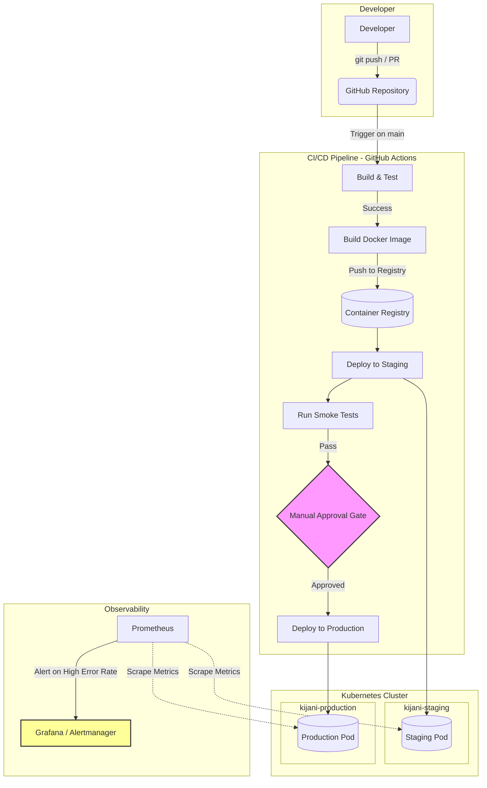

# KijaniKiosk Infrastructure Pipeline

> Track A (Infrastructure-First) Capstone — Python Flask · Docker · Kubernetes · GitHub Actions · Prometheus · Grafana

## Architecture



## Repository Structure

```
kijani-kiosk-capstone/
├── app/
│   ├── app.py              # Flask application
│   ├── Dockerfile          # Container image definition
│   └── requirements.txt    # Python dependencies
├── docs/
│   ├── scope-document.md   # CAP-1 deliverable
│   ├── peer-feedback-log.md
│   └── reflection.md
├── infra/
│   └── k8s/
│       ├── staging-deployment.yaml
│       └── prod-deployment.yaml
├── pipeline/
│   └── deploy.yml          # GitHub Actions CI/CD
└── scripts/
    └── smoke-test.sh       # Post-deploy validation
```

## Quick Start

```bash
# Run locally
cd app
pip install -r requirements.txt
python app.py

# Test endpoints
curl http://localhost:5000/health
curl http://localhost:5000/checkout
```

## Local Testing

```bash
# Make smoke test executable before running or committing
chmod +x scripts/smoke-test.sh

# Run against local app
./scripts/smoke-test.sh http://localhost:5000
```

## Environments

| Environment | Namespace | Trigger | Gate |
|-------------|-----------|---------|------|
| Staging | `kijani-staging` | Push to `main` | Automatic |
| Production | `kijani-production` | Tagged release `v*` | Manual approval |

## Dependencies & Tools Required

| Tool | Version | Purpose |
|------|---------|---------|
| Python | 3.12 | Application runtime |
| Docker | 24+ | Containerization |
| kubectl | 1.29+ | Kubernetes CLI |
| Minikube/Kind | latest | Local K8s cluster |
| Terraform | 1.7+ | Infrastructure as Code |
| Prometheus | 2.x | Metrics collection |
| Grafana | 10.x | Dashboards & alerts |
