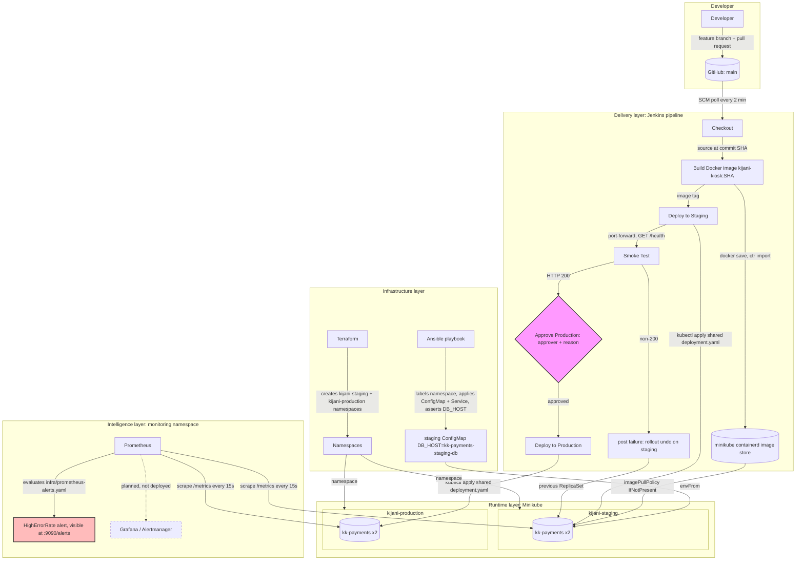

# 🌿 KijaniKiosk Infrastructure Pipeline

[](https://github.com/ob002/kijani-kiosk-capstone/blob/main/Jenkinsfile)

> **Core Objective:** A new engineer should be able to clone this repository, understand the architecture, and deploy a meaningful change to the staging environment within their first day.

---

## 1. 🗺️ Architecture


**Four-Layer Flow:**

| Layer | Component |
|-------|-----------|
| Infrastructure | Terraform provisions namespaces · Ansible configures staging (labels, ConfigMap, Service, DB_HOST check) |
| Delivery | Jenkins: build → staging deploy → smoke test → approval gate → prod deploy |
| Runtime | Kubernetes: `kijani-staging` and `kijani-production`, both 2 replicas with the same CPU/memory requests and limits (one shared manifest) |
| Intelligence | Prometheus in the `monitoring` namespace scrapes `/metrics` from all 4 kk-payments pods and evaluates `infra/prometheus-alerts.yaml`. `HighErrorRate` tested firing and resolving. Grafana/Alertmanager not deployed |

---

## 2. 🛠️ Technology Stack

- **App:** Python 3.12 (Flask)
- **Container:** Docker (with `.dockerignore`)
- **IaC:** Terraform (applied: creates both namespaces) · Ansible (`infra/ansible/configure-staging.yml`, run 2026-11-12)
- **Orchestration:** Kubernetes — namespace isolated (`kijani-staging` / `kijani-production`)
- **CI/CD:** Jenkins (Pipeline job, "Pipeline script from SCM", polls `main` every 2 min — `Jenkinsfile` at repo root, manual approval gate that records a reason)
- **Observability:** Prometheus v3.5.0 (`infra/k8s/monitoring/prometheus.yaml`, plain manifests, no Helm) · alert rules in `infra/prometheus-alerts.yaml` · app emits JSON logs and `kk_payments_*` metrics. Grafana and Alertmanager are Production Gaps

---

## 3. 🚀 Getting Started (Local Development)

### Prerequisites
- Python 3.12+
- Docker
- `kubectl` + Minikube or Kind

### Run the app locally
```bash
cd app
python3 -m venv venv
source venv/bin/activate
pip install -r requirements.txt
python app.py
```
Visit `http://localhost:5000/health` to verify.

### Build and run with Docker
```bash
docker build -t kijani-kiosk:local ./app
docker run -p 5000:5000 -e ENVIRONMENT=local kijani-kiosk:local
```

### Run smoke tests
```bash
chmod +x scripts/smoke-test.sh
./scripts/smoke-test.sh http://localhost:5000
```

### Set up the cluster (Terraform → Ansible → Prometheus)
Needs Minikube, Terraform, Ansible with `kubernetes.core` (`ansible-galaxy collection install kubernetes.core`) and the `kubernetes` Python library.
```bash
minikube start
cd infra/terraform && terraform init && terraform apply && cd ../..   # creates both namespaces
ansible-playbook infra/ansible/configure-staging.yml                # configures staging

kubectl apply -f infra/k8s/monitoring/prometheus.yaml
kubectl create configmap prometheus-rules -n monitoring \
  --from-file=alerts.yaml=infra/prometheus-alerts.yaml --dry-run=client -o yaml | kubectl apply -f -
kubectl rollout restart deployment/prometheus -n monitoring
kubectl port-forward -n monitoring svc/prometheus 9090:9090        # open http://localhost:9090/alerts
```
The app itself is deployed by Jenkins (next section), not by hand.

---

## 4. 🏗️ Deployment Pipeline

The pipeline is defined in `Jenkinsfile` at the repo root. A Jenkins Pipeline job ("Pipeline script from SCM") polls `main` every 2 minutes and runs it on change.

1. Push to `main` → Jenkins runs **Checkout → Build → Deploy to Staging → Smoke Test**
2. Smoke test must pass (HTTP 200 from `/health`) before the pipeline proceeds
3. **Approval Gate** pauses the pipeline; Jenkins records who approved and the reason they entered (the reason field is not yet enforced as non-empty)
4. Both namespaces use the same `infra/k8s/deployment.yaml` (2 replicas, same resource limits); only the ConfigMap differs per environment
5. If any stage fails, `post { failure }` runs `kubectl rollout undo` on staging

### Pipeline Stages
```
Checkout → Build Docker Image → Deploy to Staging → Smoke Test → Approve Production → Deploy to Production
```
There is no unit-test stage yet (see Production Gaps).

### Fault Scenario (Demo)
Run **Build with Parameters** with `INJECT_FAULT` ticked. The pipeline sets `FAULT_HEALTH=true` on staging, `/health` returns 500, the smoke test fails, both production stages are skipped and staging is rolled back. Evidence: [docs/evidence/](docs/evidence/README.md).

Alerting check: with `FAULT_HEALTH=true` on staging, `HighErrorRate` went from inactive to firing for `kijani-staging` only, and cleared after `kubectl rollout undo`. Evidence: [docs/evidence/prometheus-01-alert-fires.txt](docs/evidence/prometheus-01-alert-fires.txt).

Self-healing check (separate from the pipeline):
```bash
# Delete a staging pod — the ReplicaSet recreates it to keep 2 replicas
kubectl delete pod -l app=kk-payments -n kijani-staging --wait=false
kubectl get pods -n kijani-staging -w
```

---

## 5. 📂 Repository Structure

```text
├── app/                        # Flask app, Dockerfile, .dockerignore
├── docs/
│   ├── scope-document.md       # CAP-1: project scope, four layers, success criteria
│   ├── ai-governance-log.md    # CAP-3: every AI use, what it got wrong, human action
│   ├── test-plan.md            # CAP-6: written before peer review session
│   ├── peer-feedback-log.md    # CAP-6: 3 issues, severity, commit evidence
│   ├── reflection.md           # CAP-8: specific wrong decision, changed thinking
│   └── architecture.png        # Generated from Mermaid
├── infra/
│   ├── ansible/
│   │   └── configure-staging.yml   # Ansible: labels staging ns, ConfigMap, Service, DB_HOST check
│   ├── k8s/
│   │   ├── deployment.yaml         # Shared by both namespaces: 2 replicas + resource limits
│   │   ├── service.yaml
│   │   ├── staging-configmap.yaml  # DB_HOST=kk-payments-staging-db
│   │   ├── prod-configmap.yaml     # DB_HOST=kk-payments-prod-db
│   │   └── monitoring/
│   │       └── prometheus.yaml     # Prometheus Deployment, RBAC, scrape config
│   ├── terraform/                  # Creates kijani-staging and kijani-production namespaces
│   └── prometheus-alerts.yaml      # Alert rules loaded by Prometheus
├── scripts/
│   └── smoke-test.sh
└── Jenkinsfile                     # The pipeline
```

---

## 6. 🔑 Key Decisions & Trade-offs

| Decision | Chosen | Alternative | Reason |
|----------|--------|-------------|--------|
| CI/CD tool | Jenkins | GitHub Actions | Track A explicitly requires Jenkins; approval gate implemented via `input()` step that records the approver and a reason |
| Local K8s | Minikube/Kind | EKS/GKE | Zero cost for capstone; same manifest format works on cloud with no changes |
| Config management | Ansible | Helm | Ansible is already in the course stack; Helm adds templating complexity not needed at this scale |

---

## 7. 🚧 Production Gaps (What's Not Done Yet)

| Gap | Specific Fix |
|-----|--------------|
| **No Alertmanager, Grafana or kube-state-metrics** | Prometheus evaluates alerts but nothing notifies anyone, and `PodCrashLoopBackOff` cannot fire without kube-state-metrics. Prometheus also has no persistent volume. Fix: install `kube-prometheus-stack` via Helm (adds all three), route `critical` alerts to a Slack receiver, add a PVC |
| **Monitoring not in the pipeline** | Prometheus is deployed by hand (README §3). Fix: add the `kubectl apply` steps to the Ansible playbook so one command configures staging and monitoring |
| **Receipt chain not integrated** | `kk-payments` has no S3 write. Fix: add `boto3` call in `/checkout` to write to `kk-payments-receipts-staging` bucket, add bucket notification to trigger the serverless receipt chain |
| **No unit tests** | The pipeline has no test stage; the only automated check is the staging smoke test. Fix: write `pytest` tests for `/health` and `/checkout` and add a `Test` stage running `python -m pytest tests/ -v` before Deploy to Staging |
| **Prod identical to staging** | Both namespaces use the same manifest (2 replicas, same limits). Fix: Kustomize overlay or a `prod-deployment.yaml` with 3 replicas and stricter limits |
| **Approval reason not enforced** | An empty reason is accepted. Fix: `if (!env.APPROVAL_REASON?.trim()) { error('Approval reason required') }` |
| **TLS/HTTPS** | App runs plain HTTP. Fix: add `cert-manager` + Let's Encrypt `Issuer` to `infra/k8s/` |
| **Horizontal Pod Autoscaler** | No HPA. Fix: add HPA manifest targeting CPU > 70% |

---

## 📸 Evidence

Jenkins pipeline runs are documented in [docs/evidence/](docs/evidence/README.md):
- **Build #2 (green):** triggered by an SCM change, passed the smoke test and manual approval, deployed to production.
- **Build #3 (fault injection):** `INJECT_FAULT=true` made the staging health check return 500, the pipeline stopped before the approval gate, and staging was rolled back automatically. Production was not touched.
- **Ansible run:** `ansible-01-configure-staging.txt`, 7 tasks ok, 0 failed, staging `DB_HOST` asserted.
- **Prometheus:** `prometheus-00-targets-and-rules.txt` (4 pods scraped, 3 rules loaded) and `prometheus-01-alert-fires.txt` (`HighErrorRate` fires on a staging fault, clears after rollback).

## 🤝 Peer Feedback & Governance

- [docs/peer-feedback-log.md](docs/peer-feedback-log.md) — 3 issues, all resolved with commit evidence
- [docs/ai-governance-log.md](docs/ai-governance-log.md) — every AI use disclosed with "what it got wrong"
- [docs/test-plan.md](docs/test-plan.md) — written before peer review session

<details>
<summary><strong>📊 Architecture Diagram (Mermaid source for docs/architecture.png; render with `mmdc -i arch.mmd -o docs/architecture.png -s 2`)</strong></summary>


</details>
